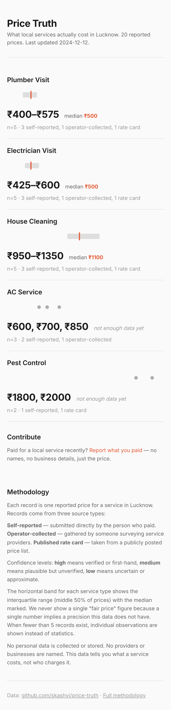

# Price Truth


*Screenshot rendered from synthetic sample data for design reference. Not real prices.*

**Live site:** TODO

Price Truth publishes an open dataset of what local home services actually cost in Lucknow, collected from reported prices. No public, structured source for this data exists in most Indian cities. The published dataset currently contains 0 records.

## What this does not do

- Does not name providers. No business or person is ever identified.
- Does not recommend anyone. This is a price index, not a directory.
- Does not show a single "fair price." A single number implies a precision this data does not have.
- Does not show a median when fewer than 5 records exist for a service type. Below that threshold, individual observations are shown with a "not enough data yet" label.

## Statistical rules enforced in code

Every statistic shown on the site is governed by rules that are tested in the test suite and cannot be bypassed:

- Medians are computed only when 5 or more records exist for a service type. The build script refuses to render a median below this threshold.
- The interquartile range (IQR) is always shown instead of a single price figure. The IQR represents the middle 50% of reported prices.
- The sample count is displayed next to every number. No statistic appears without its n.
- The source type breakdown (self-reported, operator-collected, published rate card) is shown for every service type.

## How to contribute

Paid for a local service in Lucknow recently? Report what you paid through the contribution form on the site. See [CONTRIBUTING.md](CONTRIBUTING.md) for what a usable submission contains and what will be stripped (names, phone numbers, business identifiers, provider names).

## How to run it

Requires Node 20 or later.

```bash
npm install
```

```bash
npm run validate
```

Runs the schema and personal-data rules across `data/records.json`. Exits non-zero on any violation.

```bash
npm run stats
```

Prints median, IQR, and sample count per service type and per area.

```bash
npm run build
```

Generates the static site into `site/`.

```bash
npm test
```

Runs the full test suite.

## Licensing

**Code** (everything outside `data/`): [MIT License](LICENSE), copyright Kashvi Sharma, 2026.

**Data** (`data/records.json`): [CC BY 4.0](data/LICENSE), copyright Kashvi Sharma, 2026. You may share and adapt the dataset with attribution.

See [data/DICTIONARY.md](data/DICTIONARY.md) for field definitions and known limits of the data.
